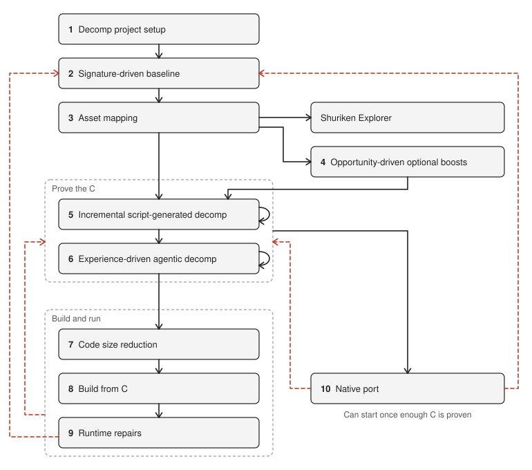

# dc-decomp-kickoff

Give Claude your Dreamcast game disc and a Katana SDK, and it starts the decompilation of your game and guides your AI agent to completion.

dc-decomp-kickoff is a **full decomp toolset**, from the disc to a game that plays on real hardware.

**Welcome to 1998!**

* **Byte-identical rebuild**, one assembly file per function
* **Functions named** from SDK signatures and your optional sources
* **Text, model, texture and audio maps**, browsable in [Shuriken Explorer](https://github.com/consolesplayingconsoles/dc-shuriken-explorer)
* **Equivalent C** proven in an SH-4 simulator, or **matching C** that rebuilds the original bytes
* **Builds the game** and a disc image from the C
* **Runtime repair** with Flycast GDB and a serial debugger (cable required)
* **Agent plan, rules and tools** in `AGENTS.md`
* **Native port tooling**

The process was worked out on real Dreamcast decomps and is refined with every game that goes through it, so each decomp is easier than the last.

## The decompilation steps

Claude uses the dc-decomp-kickoff skill to start the repo and follows these steps. **Following them can guide you all the way to 100%**, and you are free to fork at any moment and
follow your own strategy. Every step ends by printing the project's progress.



  
| #  | Step                                    | You provide                          | What it does                                                                                                                                                                                  |
|----|-----------------------------------------|--------------------------------------|-----------------------------------------------------------------------------------------------------------------------------------------------------------------------------------------------|
| 1  | **Decomp project setup**                | The disc as a `.gdi`, a Katana SDK   | Installs the tools (Docker, Python 3) and checks your game disc and SDK.                                                                                                                      |
| 2  | **Signature-driven baseline**           |                                      | Splits the executable into one assembly file per function, rebuilds it **byte for byte**, names functions by signature.                                                                       |
| 3  | **Asset mapping**                       |                                      | Writes the text, model, texture and audio maps.                                                                                                                                               |
| 4  | **Opportunity-driven optional boosts**  | [The materials](#install)            | Uses what you hand over (a later port, a prototype, cheat codes...) to save work in later steps.                                                                                              |
| 5  | **Incremental script-generated decomp** | SDK library sources                  | Matches the SDK's own library source against the original bytes, then proves script-generated C, with directed test cases for what it misses. Matching projects do matching C here.           |
| 6  | **Experience-driven agentic decomp**    |                                      | Takes what is left one pocket at a time, writing C and test cases until each function is proven. The plan is in `AGENTS.md`.                                                                  |
| 7  | **Code size reduction**                 |                                      | Shrinks the compiled C to the size of the original game code; a smaller function replaces the old one only if still proven.                                                                   |
| 8  | **Build from C**                        | The disc as a `.gdi`                 | Builds the executable and a disc image from the C (`make disc GDI="your disc.gdi"`).                                                                                                          |
| 9  | **Runtime repairs**                     | Flycast GDB, serial cable (optional) | Traces each stop to its function and step, fixes it there and builds again, until the game is stable (`status.txt`: boots to menu, playable, stable). Flycast GDB and a serial debugger help. |
| 10 | **Native port**                         |                                      | Native port tooling on top of the proven C, for running the game outside the console.                                                                                                         |

**Note:** dc-decomp-kickoff never downloads games, SDKs or any material that contains IP, and the heavy files are yours to hand over. Claude Code is preferred: Claude chat is less automatic and will ask you to run some commands yourself.

## What it reads

| Map        | Reads today                                                                                                                                                       | Otherwise                                                             |
|------------|-------------------------------------------------------------------------------------------------------------------------------------------------------------------|-----------------------------------------------------------------------|
| Executable | A boot file with the game at a fixed address                                                                                                                      | A game that loads its code from other files stops at step 1, like PSO |
| Text       | ASCII and Shift-JIS strings, with every pointer to them                                                                                                           | Other encodings and compressed text are counted per file              |
| Models     | The NAOMI library's flat format, Ninja models and motions, object trees stored as a memory image, tagged model blocks, PRM and TR4 meshes, ZIP and Quake 3 models | Other formats are not listed                                          |
| Textures   | PowerVR twiddled and VQ, through the executable's own lists, a model file's own lists, or a `textures` rule                                                       | Other formats are listed in `images.tsv`                              |
| Audio      | CRI ADX and AHX streams (loose or in AFS archives), WAV, sample streams, DTPK, SMLT and SMPB banks                                                                | Other formats are not listed                                          |

## Worked examples

| Game                        | Release                  | Repo                                                                                                  | What it is                                                                                                                    | Evidence                                                                        |
|-----------------------------|--------------------------|-------------------------------------------------------------------------------------------------------|-------------------------------------------------------------------------------------------------------------------------------|---------------------------------------------------------------------------------|
| Crazy Taxi                  | Europe, MK-51035, V1.000 | [crazy-taxi-decomp](https://github.com/consolesplayingconsoles/crazy-taxi-decomp)                     | 100% decompiled, built for modding. Plays on the console from a build from the C.                                             | [Evidence](docs/evidence.md#crazy-taxi-europe)                            |
| Virtua Tennis               | USA, MK-51054, V1.001    | [virtua-tennis-decomp](https://github.com/consolesplayingconsoles/virtua-tennis-decomp)               | 100% decompiled, started beside Crazy Taxi (shared library) for a combined mod. Plays on the console from a build from the C. | [Evidence](docs/evidence.md#virtua-tennis-usa-mk-51054-v1001)             |
| Boku Doraemon               | Japan, T-41802M, V1.003  | [boku-doraemon-decomp](https://github.com/consolesplayingconsoles/boku-doraemon-decomp)               | An experiment: a translation target.                                                                                          | [Evidence](docs/evidence.md#boku-doraemon-japan-t-41802m-v1003)           |
| Illbleed                    | Japan, T45601M, V1.003   | [illbleed-decomp](https://github.com/consolesplayingconsoles/illbleed-decomp)                         | An experiment: a second translation target, also doable.                                                                      | [Evidence](docs/evidence.md#illbleed-japan-crazy-games-t45601m-v1003)     |
| Sonic Adventure             | Europe, MK-51000, V1.003 | [sonic-adventure-decomp](https://github.com/consolesplayingconsoles/sonic-adventure-decomp)           | Names and maps (text, models, textures, sounds).                                                                              | [Evidence](docs/evidence.md#sonic-adventure-europe-mk-51000-v1003)              |
| Zombie Revenge              | Europe, MK-51038, V1.000 | [zombie-revenge-decomp](https://github.com/consolesplayingconsoles/zombie-revenge-decomp)             | 100% decompiled, the SDK's own source verified. Plays on the console from a build from the C.                                 | [Evidence](docs/evidence.md#zombie-revenge-europe-mk-51038-v1000)         |
| Power Stone                 | USA, T-1201N, V1.001     | [powerstone-decomp](https://github.com/Subarasheese/powerstone-decomp) (another author's)             | Follows the kickoff: most functions proven as Equivalent C, with a build from the C.                                          | None yet                                                                        |
| Power Stone 2               | USA, T-1211N, V1.000     | [powerstone2-decomp](https://github.com/Subarasheese/powerstone2-decomp) (same author as Power Stone) | Follows the kickoff: the game's own code 100% proven as Equivalent C; libraries not done, no build from the C yet.            | None yet                                                                        |
| Virtua Fighter 3            | US, MK-51001, V1.002     | [vf3-decomp](https://github.com/celsowm/vf3-decomp) (another team's)                                  | An experiment: names for their decomp ([the merged PR](https://github.com/celsowm/vf3-decomp/pull/1)).                        | [Evidence](docs/evidence.md#virtua-fighter-3tb-us-mk-51001-v1002)         |
| Phantasy Star Online Ver. 2 | US, MK-51193, V1.004     | None                                                                                                  | **Not compatible**: its code loads from over 600 files at runtime, so the kickoff stops at step 1.                            | [Evidence](docs/evidence.md#phantasy-star-online-ver-2-us-mk-51193-v1004) |

## Evidence and method

- [docs/evidence.md](docs/evidence.md): Records what dc-decomp-kickoff did on each game it has run on. If you run your own decomp please share the generated evidence so the tool can grow.

- [docs/equivalent-pipeline.md](docs/equivalent-pipeline.md): Explains how Equivalent C is written and checked at scale. [SKILL.md](SKILL.md) is the procedure Claude follows.

- [docs/matching-c.md](docs/matching-c.md) and [docs/matching-units.md](docs/matching-units.md): Explain how matching C is written, one source file at a time.

- [scripts/](scripts/), [template/](template/) and [docs/](docs/): hold what it runs and copies into each repo.

## Install

dc-decomp-kickoff is a skill folder: [SKILL.md](SKILL.md) plus the [scripts/](scripts/), [template/](template/) and [docs/](docs/) it runs.
Install the whole folder when possible. Where only [SKILL.md](SKILL.md) can be added, dc-decomp-kickoff fetches the rest itself.

* **Claude Code:** clone it into your skills folder, then run `/dc-decomp-kickoff` to start a decomp of your game:
  ```
  git clone https://github.com/consolesplayingconsoles/dc-decomp-kickoff ~/.claude/skills/dc-decomp-kickoff
  ```
  The work runs on your machine, with your game and SDK images where they already are.

**What you provide:** the game disc as a `.gdi` with its track files (only `.gdi`) and a Katana SDK. dc-decomp-kickoff reads the disc and reports which SDK
release it was built with; that release's library sources, or those of another release, are accepted as well. Python 3 is required
wherever it runs, and Docker on any OS. Without Docker (Linux x86_64 only), `scripts/setup_tools.sh` installs the tools
dc-decomp-kickoff needs, one step at a time. To debug the running game you need Flycast, or a serial cable for real hardware.

**Optional, and worth having:** each of these saves work, and the earlier it is used the more it saves (the SDK's own source is the clearest case). dc-decomp-kickoff asks for them
one by one (a path, a link, or "no"), and only uses what you give it: it never fetches games, SDKs or any other material that contains intellectual property.

| # | Material                                               | What it gives you                                                                                                                                                                                                          |
|---|--------------------------------------------------------|----------------------------------------------------------------------------------------------------------------------------------------------------------------------------------------------------------------------------|
| 1 | A later port                                           | The big one when it kept its symbol table: it can name a large share of the functions and globals. **Android** (an `.apk`) is particularly effective; **PC** ports rarely carry symbols. iOS and other consoles count too. |
| 2 | A prototype, debug build or dev kit dump               | Pre-release discs sometimes carry the linker's `.ELF` or `.MAP`, or a build log, with every name. Debug text left in early builds names what it prints.                                                                    |
| 3 | Cheat codes for the game                               | A saved code list (CodeBreaker or Xploder format, or a saved gamehacking.org page). Every code is an address with a meaning: named variables. Widescreen codes count too.                                                  |
| 4 | Other regions or revisions                             | The same code, so names and addresses carry across.                                                                                                                                                                        |
| 5 | Existing reverse-engineering notes or a partial decomp | A repo, thread or wiki page: reference names and pitfalls.                                                                                                                                                                 |
| 6 | A decomp of the same game on another console           | Structures, class names and logic; no bytes match.                                                                                                                                                                         |
| 7 | A sibling decomp                                       | Names for library code shared with another game from the same team: exact matches only, from a repo you name.                                                                                                              |

## Third-party sources

The procedure needs a Katana SDK. The repositories
named in dc-decomp-kickoff are identified solely as examples of the type of material required. We have no
affiliation with, and make no representation regarding, those repositories, their contents, or
their licensing. Nothing is retrieved without your confirmation, and you are solely responsible for
determining whether you are entitled to obtain and use any such material.

## About the author

- 📸 **Instagram:** [@consolesplayingconsoles](https://www.instagram.com/consolesplayingconsoles/)
- 🔗 **Everything else:** [beacons.ai/consolesplayingconsoles](https://beacons.ai/consolesplayingconsoles)
