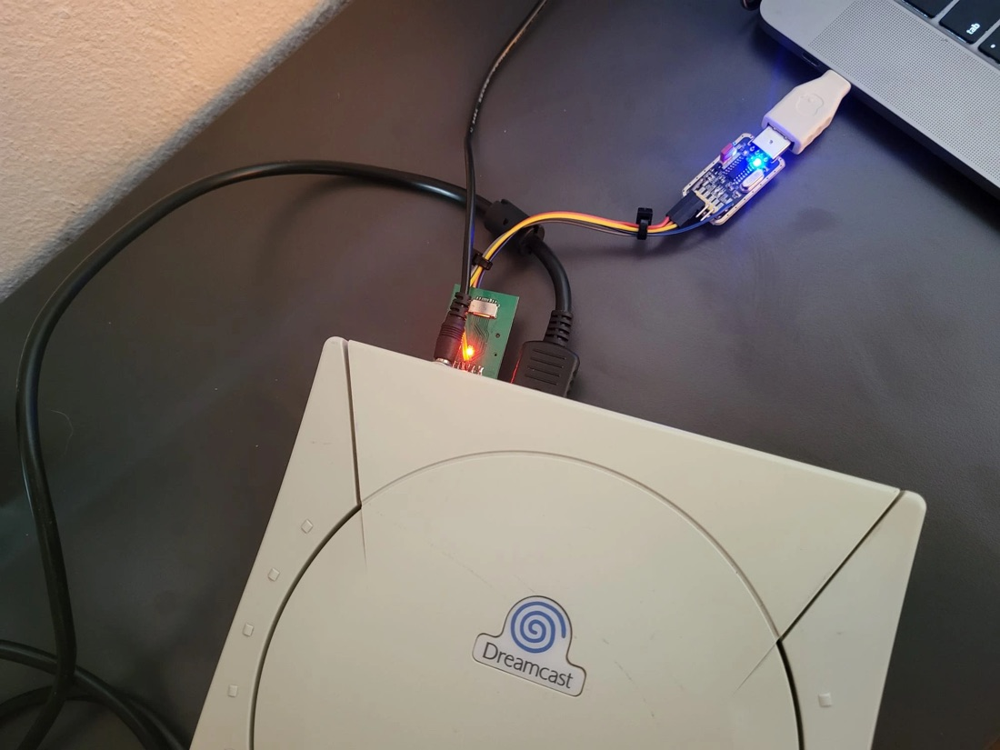

# Development tools

Tools for developers working on the dc-decomp-kickoff itself.

| tool | what it is |
|---|---|
| [hwverify.py](hwverify.py) | A runner for a function's test cases on the simulator and on the real console. |

## What you need

| part | notes |
|---|---|
| A Dreamcast with the **dcload-serial 1.0.7-cpc** loader running | consolesplayingconsoles fork of KallistiOS's `dcload-serial` 1.0.7: the stock loader starts programs with SR.BL set, so a crash resets the console; the fork clears it and sends the crash registers to the PC, which hwverify logs as `CONSOLE CRASH`. |
| `dc-tool-ser` from the same build on your PATH | The host side of the same source. |
| The `sh-elf` toolchain on your PATH | `sh-elf-gcc` builds the small program that runs on the console (KallistiOS's `kos-chain` builds it). |
| The coder's cable | See next section.|

## The coder's cable

Sources:

- [Coder's cable](https://dreamcast.wiki/Coder%27s_cable) and [Serial interface](https://dreamcast.wiki/Serial_interface) on dreamcast.wiki: the parts, the pins, the supported baud rates.
- [dcload-serial](https://github.com/KallistiOS/dcload-serial) (its README): the loader, `dc-tool-ser` and the speeds they use.
- [cepawiel/dc-serial](https://github.com/cepawiel/dc-serial): a ready-made board for the plug of an SD-card adapter.



## hwverify.py

```
hwverify.py REPO FUNCTION --runtime DIR [--port DEVICE] [--baud 57600] [--wait SECONDS] [--log FILE] [--dry-run]
```

`REPO` is a decomp repo (`1ST_READ.BIN`, `BASE`, `functions.txt`, `tests/<unit>/<FUNCTION>.json`, `tools/sim/sh4sim.py`).

1. It finds the console: each USB serial adapter is asked for the loader's version, and the one that answers is used. The
   adapter's number changes when the cable is replugged, so the port is never named (`--port` forces one). `--wait`
   keeps asking until the console answers or the time is up.
2. It copies the function's own bytes, and the literal pool its pc-relative loads reach, into the console's RAM at their
   real addresses, runs each case (registers r4-r7 and memory words set first), and prints r0 and the words the case set.
   Each callee gets a stub at its address that records the call (target, r4-r7, the stack word) and answers the case's
   scripted r0, as the simulator's mocked callees do. The words the original reads in the simulator are poked first with
   what the simulator had there, and the stack below the function is zeroed, as the simulator's is.
3. It runs the same case in `tools/sim/sh4sim.py` and compares: r0, the final word at each address the case set, and the
   calls in order.

Every step is printed with the time and also written to `--log`. A case prints `MATCH`, `DIFFER` (with both values),
`NO CONSOLE RESULT`, `CONSOLE CRASH` (with the loader's exception line: the exception, PC, PR, SR and R0-R15; the
cases after it are `NOT RUN`), or `NOT RUN` with the reason. Exit status: 0 every case matched, 1 a case differed, the
console printed nothing or crashed, 2 nothing could be run.

`--dry-run` writes the C program the console would run and stops: no console needed. It exits 0 when the program was
written.

### What it can and cannot run

- Calls whose target is known before the run: a `bsr`/`bra` out of the function, or a `jsr`/`jmp` through a register
  loaded from the literal pool. A computed target is refused with its reason.
- Integer arguments in r4-r7, whole-word memory writes, call answers in r0. A case with a RAM dump, a float register,
  any other register or another kind of call answer is reported `NOT RUN` with its reason, never skipped silently.
- A case whose simulated run reads outside RAM (the boot ROM, open bus) is `NOT RUN`: the simulator answers 0 there,
  the console the real bytes, and a function walking what it read can hang the console.
- Memory the function writes outside the words the case set is not compared.

### How the program on the console is made

The code runs from the uncached mirror of its address; memory the function reads or writes is touched at the cached
address the function itself uses. Writing through one mirror while the function reads the other gives wrong answers from
a stale cache line. The program copies the code into place first, then prints `hwverify start` and `hwverify done` around the
cases, and each result is a whole line in one write: a program that prints in fragments puts the loader's protocol out of step.

The loader's startup code (`crt0`) clears the BSS with 4-byte stores from `_edata`. When the read-only data before it
ends on an odd address, the first store is an address error and the console stops answering before `main` runs. The
program keeps one initialized word in `.data` so `_edata` always lands on a word, and the tool reads `_edata` from the
linked program and refuses to upload one that is not aligned.

### When a case crashes the console

The loader catches the exception, sends its registers to the PC (logged as `CONSOLE CRASH`) and goes back to
`dcload-serial 1.0.7-cpc idle`, ready for the next run. A program that hangs instead never reaches the loader: the
console stops answering, and the cable is replugged and the disc rebooted. The `hwverify ...` lines in the log show how
far a program got before it stopped.

## Not here yet

Running the whole generator on the console (slow, exact), and running it in shadow mode on both the console and the
simulator, comparing as it goes. This tool is the base for both: one function, the same cases, both machines.
